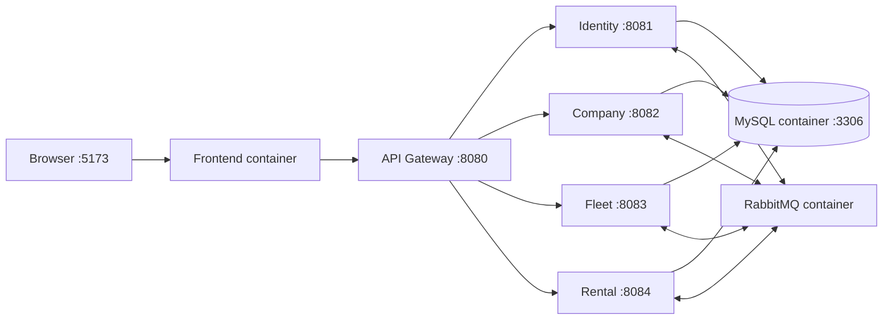

# RentFlow

RentFlow is a multi-tenant vehicle-rental management application built as a Java/Spring microservices monorepo with a React frontend. This repository is a separate project from `~/Developer/Rental Saas`.

> **Development status:** The Docker stack, authentication demo, tenant-scoped fleet and rental APIs, and fictional demo records are runnable. This is not yet a production-ready SaaS release. Review the implementation checklist for outstanding work.

## Architecture



### Services and responsibilities

| Component | Container | Port | Responsibility |
|---|---|---:|---|
| Frontend | `frontend` | 5173 | React, TypeScript, MUI, application navigation and forms |
| API Gateway | `api-gateway` | 8080 | Browser entry point, JWT validation, and routing |
| Identity Service | `identity-service` | 8081 | Demo login, BCrypt password hashes, access and refresh tokens, roles |
| Company Service | `company-service` | 8082 | Company records and initial admin provisioning |
| Fleet Service | `fleet-service` | 8083 | Tenant-scoped vehicles and drivers |
| Rental Service | `rental-service` | 8084 | Tenant-scoped customers, bookings, payments, and trips |
| MySQL | `mysql` | 3306 | One MySQL 8.4 container hosting four service-owned logical databases |
| RabbitMQ | `rabbitmq` | 5672 / 15672 | Local message broker; management UI is on port 15672 |

Only the gateway, frontend, MySQL, and RabbitMQ ports are published to the host. The four application services are separate containers, but their ports are private to the Compose network. Each service owns its schema and Flyway migrations; the services do not share tables.

MySQL creates these databases:

- `rentflow_identity`
- `rentflow_company`
- `rentflow_fleet`
- `rentflow_rental`

Compose also creates project-specific named data volumes. This project uses `rentflow_rentflow_mysql_data` and `rentflow_rentflow_rabbitmq_data`; the old project's `rentalsaas_rentflow_mysql_data` volume is not mounted or modified.

## Start the application

Prerequisites: Docker Desktop with Compose, Java 21 and Maven 3.9+ for local backend commands, and Node.js 24+ for local frontend commands.

1. Copy `.env.example` to `.env`.
2. Replace the placeholder passwords and secrets in `.env`, including `DEMO_SEED_PASSWORD`, `JWT_SECRET`, and `INTERNAL_PROVISIONING_KEY`. Keep `.env` private; it is ignored by Git.
3. From the repository root, build and start the full stack:

   ```bash
   docker compose up -d --build
   ```

4. Open [http://localhost:5173](http://localhost:5173). The API gateway is at [http://localhost:8080](http://localhost:8080).

Check container status and logs:

```bash
docker compose ps
docker compose logs -f
```

Stop containers while preserving databases and message data:

```bash
docker compose stop
```

Start only the infrastructure containers:

```bash
docker compose up -d mysql rabbitmq
```

Do not use `docker compose down -v` if you want to keep this project's data.

## Local demo data and login

When the services start, they idempotently seed the fictional RentFlow demo records: Acme Rentals and Zenith Motors, three vehicles, two customers, three demo users, one confirmed Acme booking, and its pending payment. The records use `.test` email addresses. No rows are copied from the old project's database volume.

The demo accounts are:

- `superadmin@rentflow.test`
- `admin@acme-rentals.test`
- `admin@zenith-motors.test`

All use the password configured as `DEMO_SEED_PASSWORD` in the local `.env`. Passwords are stored as BCrypt hashes. The seeder is enabled for this local Compose setup; it is disabled by default in service configuration.

## API areas

- Authentication: `/api/v1/auth`
- Companies: `/api/v1/companies` (Super Admin)
- Fleet: `/api/v1/vehicles`, `/api/v1/drivers`
- Rentals: `/api/v1/customers`, `/api/v1/bookings`, `/api/v1/payments`, `/api/v1/trips`

Business services derive tenant identity from validated authentication context and scope repository access to that tenant. Booking periods use `[startAt, endAt)` intervals, so adjacent bookings do not overlap.

## Development and tests

Backend build and tests:

```bash
mvn test
```

Frontend:

```bash
cd frontend
npm ci
npm test
npm run build
```

Validate Compose configuration:

```bash
docker compose config --quiet
```

## Project layout

```text
backend/
  api-gateway/
  identity-service/
  company-service/
  fleet-service/
  rental-service/
frontend/
infrastructure/
docs/
docker-compose.yml
pom.xml
```

See [`docs/architecture.md`](docs/architecture.md), [`docs/service-boundaries.md`](docs/service-boundaries.md), [`docs/database-design.md`](docs/database-design.md), [`docs/demo-data.md`](docs/demo-data.md), and [`docs/implementation-checklist.md`](docs/implementation-checklist.md) for additional details and remaining work.
