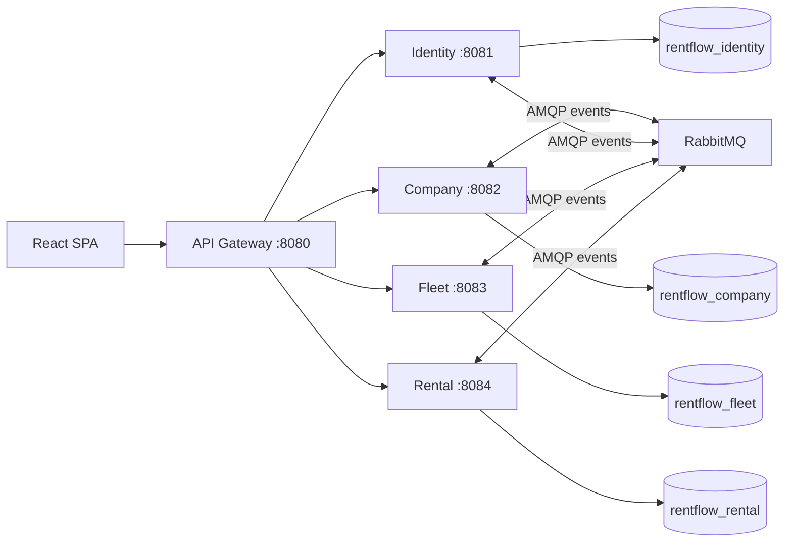

# RentFlow Architecture

## Architectural style

RentFlow uses independent Spring Boot microservices behind a Spring Cloud API Gateway. The React application calls only gateway routes. Each service owns a logical MySQL database and publishes domain events through RabbitMQ when cross-service consistency is required.

## Services

| Service | Port | Database | Responsibility |
|---|---:|---|---|
| API Gateway | 8080 | None | Routing, gateway JWT validation, CORS, correlation IDs, rate limiting |
| Identity | 8081 | rentflow_identity | Authentication, refresh tokens, users, roles, memberships |
| Company | 8082 | rentflow_company | Company lifecycle and provisioning orchestration |
| Fleet | 8083 | rentflow_fleet | Vehicles, categories and drivers |
| Rental | 8084 | rentflow_rental | Customers, bookings, payments and trips |

## Communication rules

- External HTTP traffic enters through the API Gateway.
- Services enforce authorization and tenant context independently.
- Service-to-service HTTP is avoided for core workflows where events provide a safer boundary.
- No service has direct access to another service database.
- Cross-service identifiers are UUIDs.
- RabbitMQ events carry correlation IDs and are idempotent.
- Distributed workflows use an orchestrated saga and explicit provisioning state.

## Tenant security

The authenticated user ID and role are derived from a validated JWT. The business service resolves company membership and company status, never trusts a client-supplied company ID, and applies the tenant company ID to every query and mutation.

SUPER_ADMIN has explicitly defined platform permissions. COMPANY_ADMIN is limited to its authorized company. EMPLOYEE receives only operational permissions for rental workflows.

## Booking consistency

Booking intervals use an exclusive end date: `[start, end)`. This means a booking through January 14 and another starting January 15 do not overlap. The Rental service validates ownership and availability transactionally and uses database locking or constraints to prevent concurrent conflicts.

## Documentation boundaries

Detailed decisions will be maintained in the service and operational documents under `docs/`.
